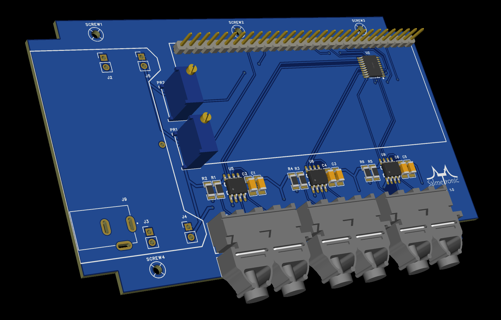

# 🧩 PCB Design · Salmetronic

Repositorio central de diseños de PCB de desarrollo propio. Cada diseño se organiza en su propia carpeta con documentación, renders y esquemático.

---

## 📚 Diseños

| Proyecto | Descripción | Versión | Documentación |
| :--- | :--- | :---: | :--- |
| **[SPWM_EGS032](SPWM_EGS032/)** | Interfaz de disparo por fibra óptica para variadores de frecuencia (VFD) e inversores solares | 1.0 | [README](SPWM_EGS032/README.md) · [Esquemático](SPWM_EGS032/docs/esquemas.pdf) |

<p align="center">
  <a href="SPWM_EGS032/README.md">
    
  </a>
</p>

---

## 🗂️ Estructura del repositorio

```text
pcb-design/
├── .gitattributes            # Tratamiento de archivos binarios
├── .gitignore                # Archivos temporales y fuentes no publicadas
├── LICENSE                   # Licencia CERN-OHL-S v2
├── README.md                 # Índice del repositorio
└── SPWM_EGS032/
    ├── README.md             # Documentación de la placa
    ├── assets/               # Logo, renders y capturas
    └── docs/                 # Esquemático en PDF
```

---

## 📄 Licencia

Los diseños de este repositorio se publican bajo la **CERN Open Hardware Licence v2 – Strongly Reciprocal (CERN-OHL-S v2)**. Consulta el texto completo en [LICENSE](LICENSE).

Copyright © 2026 **Salmetronic**.
