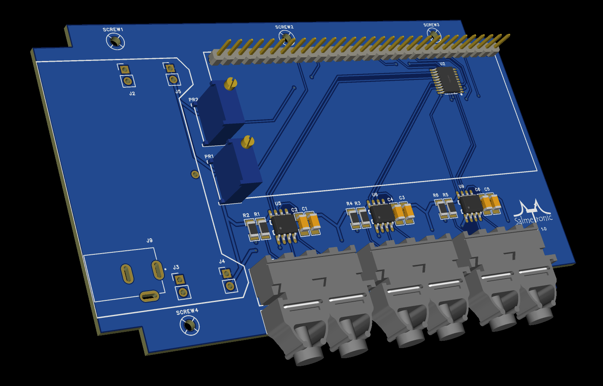
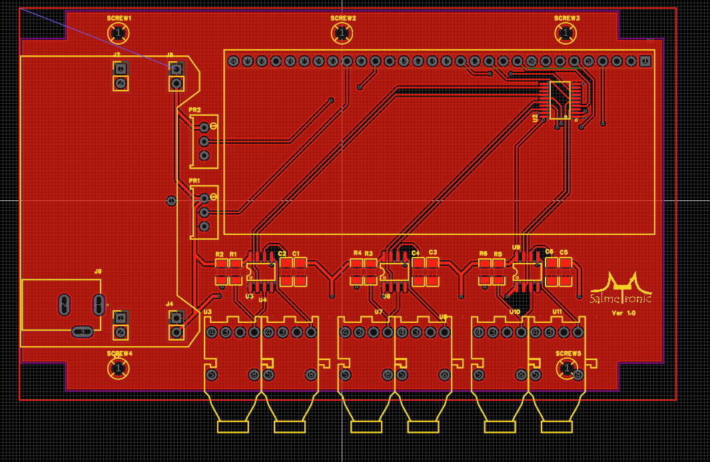
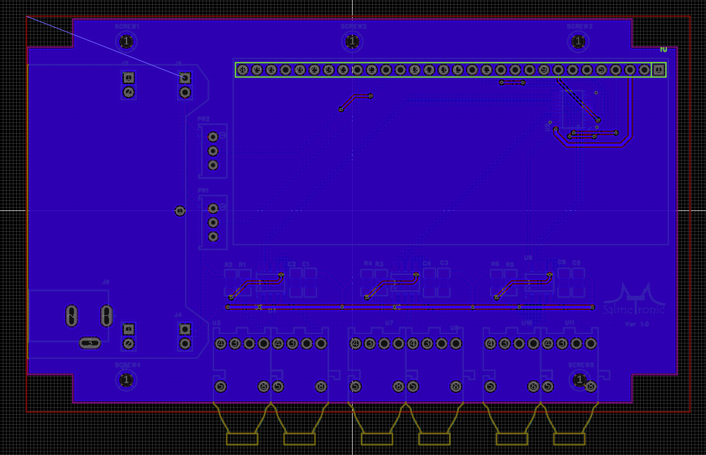
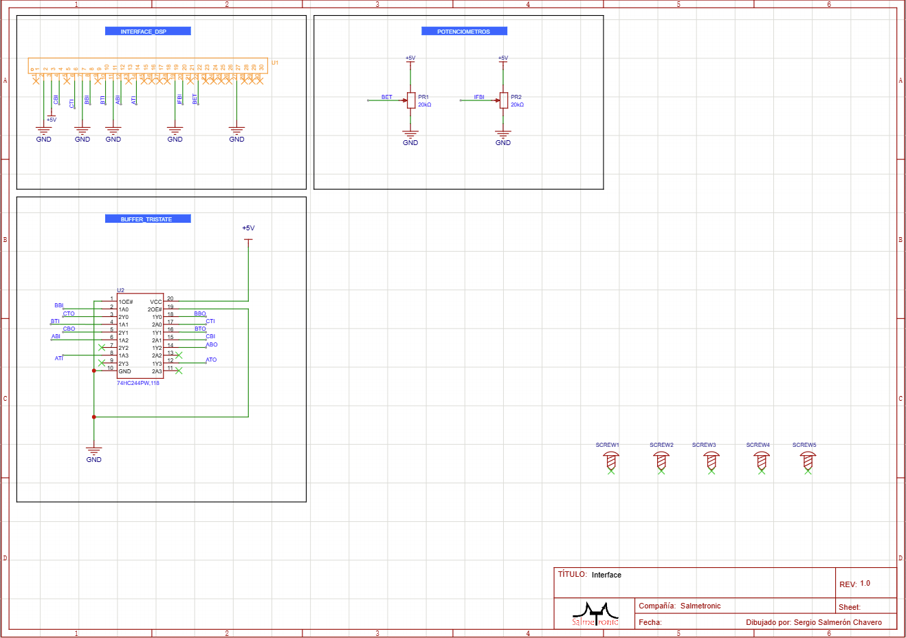
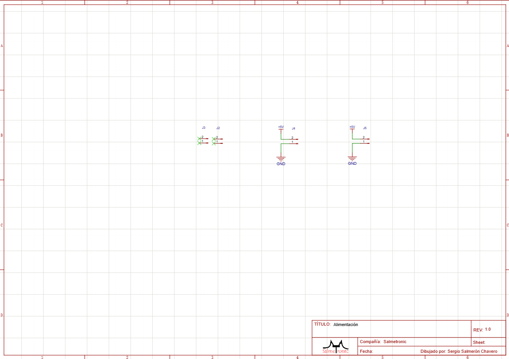
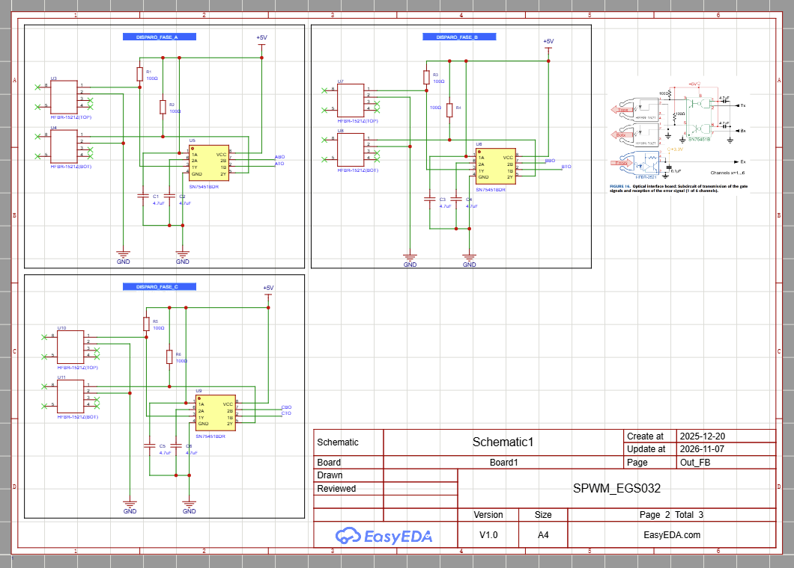

<p align="center">
  
</p>

<h1 align="center">SPWM_EGS032 · Interfaz de disparo por fibra óptica</h1>

<p align="center">
  <b>Placa adaptadora de control y aislamiento galvánico por fibra óptica para variadores de frecuencia (VFD) e inversores solares.</b>
</p>

<p align="center">
  
  
  
</p>

<p align="center">
  
</p>

---

## 📑 Índice

- [Descripción](#-descripción)
- [Características principales](#-características-principales)
- [Especificaciones técnicas](#-especificaciones-técnicas)
- [Esquemático](#-esquemático)
- [Galería de la PCB](#-galería-de-la-pcb)
- [Estructura del repositorio](#-estructura-del-repositorio)
- [Seguridad](#-seguridad)
- [Licencia](#-licencia)
- [Autor](#-autor)

---

## ⚡ Descripción

Esta placa de circuito impreso (PCB) de desarrollo propio integra un módulo controlador SPWM comercial **EGS032** junto con un conversor DC-DC aislado. Su función es procesar, adaptar y aislar las señales de control para alimentar una **interfaz de salida por fibra óptica**, orientada al disparo de compuertas (*gate driving*) en etapas de potencia de **variadores de frecuencia (VFD)** e **inversores solares**.

El diseño prioriza la inmunidad frente al ruido electromagnético (EMI) típico de los entornos de conmutación de alta potencia, garantizando una transmisión de pulsos limpia y segura hacia los módulos de potencia remotos (IGBTs / MOSFETs).

## 🚀 Características principales

- **Control SPWM optimizado:** área de inserción y zócalos dedicados para el módulo controlador **EGS032**.
- **Alimentación aislada:** integración de un módulo conversor DC-DC compacto para alimentar de forma independiente la circuitería lógica y los drivers de salida.
- **Interfaz óptica de alta velocidad:** canales de transmisión por fibra óptica con **aislamiento galvánico absoluto** entre el circuito de control de baja tensión y la circuitería de potencia.
- **Acondicionamiento de señal:** etapa de búferes y adaptación de pulsos con componentes discretos y circuitos integrados dedicados (**74HC244PW**) para asegurar flancos rápidos y evitar falsos disparos.
- **Robustez industrial:** diseño enfocado en la minimización de lazos de masa y protección contra transitorios en banco de pruebas de taller.

## 📋 Especificaciones técnicas

| Parámetro | Valor |
| :--- | :--- |
| Versión de hardware | **Ver 1.0** |
| Controlador principal | Módulo **EGS032** (EG8030 / EG8032) |
| Búfer de interfaz | **74HC244PW** (octal buffer tri-state) |
| Transmisores ópticos | **HFBR-1521Z** (fibra plástica) |
| Medio de transmisión | Enlaces ópticos dedicados para fibra polimérica / industrial |
| Alimentación | Conversor DC-DC aislado integrado |
| Aplicaciones | Bancos de prueba y reparación de VFD; tarjetas de disparo para inversores y sistemas fotovoltaicos |

## 📐 Esquemático

El esquemático completo está disponible en **[docs/esquemas.pdf](docs/esquemas.pdf)** e incluye tres hojas:

1. **Interface** — interfaz DSP/LCD y búfer tri-state 74HC244.
2. **Out_FB** — etapa de salida y transceptores de fibra óptica HFBR-1521Z.
3. **Power** — distribución de alimentación y conversor DC-DC aislado.

## 🖼️ Galería de la PCB

| Vista superior | Vista inferior |
| :---: | :---: |
|  |  |

| Interfaz DSP/LCD | Alimentación |
| :---: | :---: |
|  |  |

<p align="center">
  
</p>

## 📂 Estructura del repositorio

```text
pcb-design/
├── .gitattributes               # Tratamiento de archivos binarios
├── .gitignore                   # Archivos temporales y fuentes no publicadas
├── LICENSE                      # Licencia CC BY-NC-SA 4.0
├── README.md                    # Índice del repositorio
└── SPWM_EGS032/
    ├── README.md                # Documentación de esta placa
    ├── assets/                  # Logo, renders 3D y capturas de la PCB
    │   ├── 180pixel.png
    │   ├── imagen-3D.png
    │   ├── top.png
    │   ├── bottom.png
    │   ├── interface.png
    │   ├── power.png
    │   └── salida.png
    └── docs/
        └── esquemas.pdf         # Esquemático completo (3 páginas)
```

> **Nota:** los archivos fuente de EasyEDA Pro (`*.eprj2`) no se publican en este repositorio. Si necesitas el diseño editable, solicítalo al autor.

## ⚠️ Seguridad

Este diseño está pensado para trabajar en entornos de **potencia** y **alta tensión**. La manipulación, el montaje y la puesta en marcha debe realizarlos **personal técnico cualificado**, siguiendo los procedimientos de seguridad del banco de pruebas y la normativa aplicable. No conectar ni manipular la placa con la alimentación activa.

## 📄 Licencia

La documentación y los recursos gráficos de este proyecto se publican bajo la licencia **Creative Commons Reconocimiento-NoComercial-CompartirIgual 4.0 Internacional (CC BY-NC-SA 4.0)**. Consulta el texto completo en [LICENSE](../LICENSE).

## 🛡️ Propiedad intelectual y marca

© 2026 **Salmetronic**. El nombre comercial «Salmetronic» y su logotipo son marcas protegidas y **no** están cubiertas por la licencia de contenido. Queda prohibido su uso para la comercialización o distribución de productos de terceros sin autorización previa por escrito.

## 👤 Autor

**Salmetronic** — Diseño y desarrollo de hardware de potencia.
